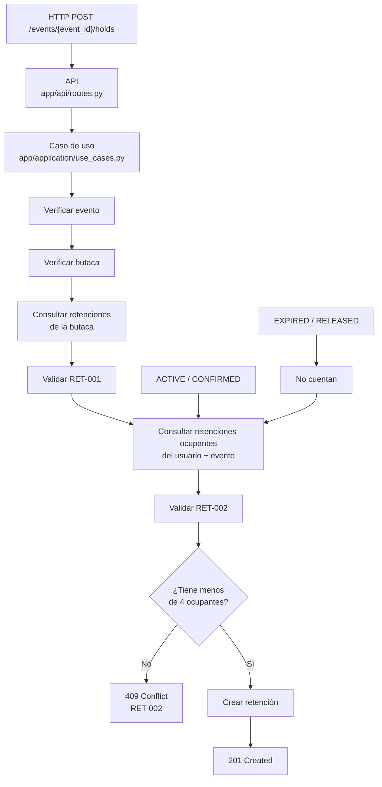

# Diagrama de flujo — RET-002

## Límite de butacas ocupantes por usuario y evento

## Estados considerados

- `ACTIVE`: cuenta como butaca ocupante.
- `CONFIRMED`: cuenta como butaca ocupante.
- `EXPIRED`: no cuenta.
- `RELEASED`: no cuenta.

## Alcance de la garantía

La implementación actual realiza la secuencia:

**leer → validar → insertar**

La verificación secuencial está cubierta por los tests y la colección de Postman. La operación todavía no es atómica frente a solicitudes concurrentes, por lo que no se afirma una garantía completa bajo concurrencia.